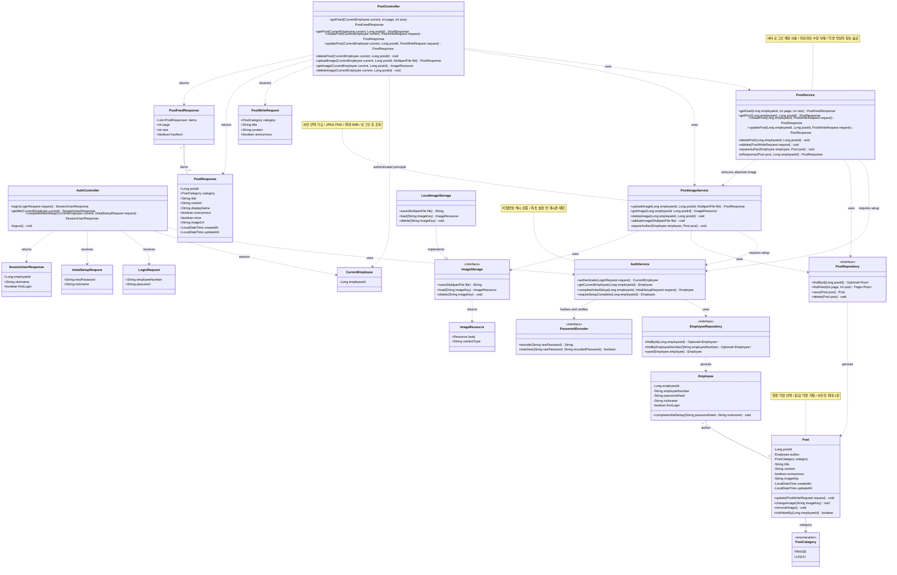
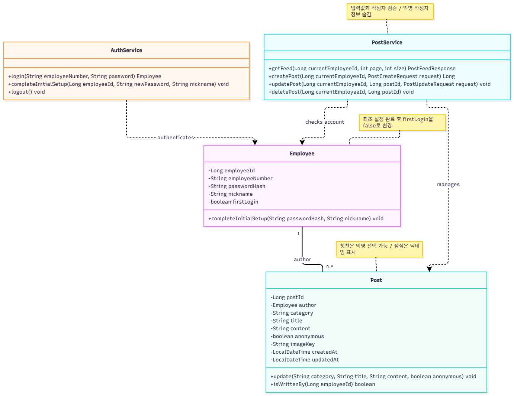

# 사내 게시판 클래스 설계 v1.0

**작성 기준:** 2026.10.21 · **담당:** M5 유은혜

구현할 기능 전체를 기준으로 작성한 클래스 설계입니다. 실제 구현·기능 시험 완료를 뜻하지 않으며, 개발 과정에서 실제 코드와 대조해 갱신합니다.

## 파일

- [편집 가능한 draw.io 설계 v1.0](post-class-diagram-v1.0.drawio)
- [전체 Mermaid 소스 코드](post-class-diagram-v1.0.mmd)
- [게시판 ERD](erd.md)

draw.io 파일은 01 전체 구조, 02 인증과 최초 설정, 03 게시글과 피드, 04 선택 사진 처리의 4페이지입니다. 전체 구조 페이지는 연결 관계를 중심으로 속성·메서드를 일부만 표시하고, 상세 페이지와 Mermaid 소스에 전체 내용을 수록합니다.

## 담당과 구현 범위

M5가 개발 설계·코드 작성·기능 검증을 담당합니다. M3는 전달받은 한국 OTT·AI 앱을 인프라에 배포하고 실행 환경과 연결·로그를 확인합니다. 한국·독일 게시판은 각각 M1·M2가 배포합니다. M3를 애플리케이션 개발 검토 담당으로 지정하지 않습니다.

미리 생성한 직원 계정의 로그인·최초 설정, 칭찬·점심 통합 피드, 글 등록·본인 글 수정·삭제, 칭찬의 익명 선택, 선택 사진 최대 1장을 설계에 포함합니다. 텍스트 기능을 먼저 구현하고 사진 기능을 추가합니다. 댓글·좋아요·회원가입·자동 광고 판별은 포함하지 않습니다.

## 클래스별 책임

| 구분 | 클래스 | 책임 |
|---|---|---|
| 요청 처리 | AuthController, PostController | 요청·응답 변환, 서버 로그인 정보 전달, 세션 생성·갱신·종료 |
| 업무 처리 | AuthService | 비밀번호 검증, 최초 설정, 설정 완료 여부 확인 |
| 업무 처리 | PostService | 피드와 글 조회·등록·수정·삭제, 입력·작성자 권한 검증 |
| 선택 사진 | PostImageService | 사진 검사·첨부·교체·삭제·조회, 접근 권한 검사 |
| 데이터 | Employee, Post, PostCategory | 직원·게시글 정보와 칭찬/점심 분류 |
| DB 접근 | EmployeeRepository, PostRepository | 조회·저장·삭제 |
| 인증 정보 | CurrentEmployee | 서버가 확인한 직원 ID |
| 비밀번호 | PasswordEncoder | 해시 생성과 일치 여부 확인에 사용할 외부 인터페이스 |
| 요청 DTO | LoginRequest, InitialSetupRequest, PostWriteRequest | 화면에서 입력한 값 |
| 응답 DTO | SessionUserResponse, PostResponse, PostFeedResponse | 화면에 공개할 값만 반환 |
| 파일 저장 | ImageStorage, LocalImageStorage, ImageResource | 저장 구현 분리와 파일 응답 |

Repository·PasswordEncoder는 구현 시 프레임워크 인터페이스에 연결합니다. MultipartFile·Resource·Optional·Page·List·LocalDateTime은 외부 또는 표준 타입이므로 별도 업무 클래스로 그리지 않았습니다.

## 처리 규칙

- 첫 구현의 인증은 세션 기반으로 설계합니다. 로그인 시 세션을 생성하고 최초 설정 완료 시 세션 정보를 갱신합니다. 로그아웃 시 세션을 무효화합니다. 한국·독일의 DB·계정·세션 환경은 분리합니다.
- 최초 설정 전에는 최초 설정과 본인 상태 조회·로그아웃만 허용하고 게시글·사진 처리를 제한합니다. 서버는 DB의 설정 완료 여부를 확인합니다.
- 공통 초기 비밀번호 1234를 배포하지 않고 계정별 임시 비밀번호를 사용합니다. 비밀번호는 해시로 보관합니다.
- 직원 ID는 인증된 서버 정보에서 가져옵니다. 요청 DTO에 직원 ID·게시글 ID·작성 시각을 넣어 작성자를 지정하게 하지 않습니다.
- 제목·본문은 공백뿐이면 거절하고 category는 PRAISE/LUNCH만 허용합니다. LUNCH와 anonymous=true의 조합은 거절합니다.
- 수정·삭제·사진 변경은 실제 작성자만 허용합니다. mine은 화면 표시용이며 서버 권한 검증을 대신하지 않습니다.
- 익명 글의 응답에는 실제 작성자 ID·직원 번호·닉네임을 포함하지 않고 displayName을 익명으로 표시합니다. 공개 글 응답 DTO에도 작성자 ID와 비밀번호 해시를 넣지 않습니다.
- 피드는 작성 시각 내림차순, 같은 시각이면 게시글 ID 내림차순으로 정렬하고 page·size와 hasNext로 나눠 조회합니다. getPost는 등록·수정 결과 확인용으로도 사용할 수 있으며 별도 상세 화면을 요구하지 않습니다.
- 처음 저장할 때 createdAt·updatedAt을 같은 서버 시각으로 기록하고 수정 시 updatedAt을 갱신합니다.
- 사진은 웹 공개 폴더 밖의 로컬 저장소를 첫 구현 기준으로 두고 서버가 파일명을 생성합니다. JPEG/PNG·최대 5MB를 초기 검사 기준으로 제안하며 파일 내용·형식·크기를 검사합니다. 실제 저장 위치와 제한은 실행 규격에서 확정합니다.
- imageUrl은 로그인과 최초 설정 확인을 거치는 사진 조회 경로입니다. 원본 로컬 경로·imageKey를 그대로 응답하지 않습니다.
- 사진 업로드 실패 시 기존 글과 사진을 유지합니다. 교체 시 새 파일 저장과 DB 반영 성공 후 기존 파일을 정리하고 실패 시 새 파일을 정리합니다. 글 삭제와 파일 정리 실패는 구분해 기록·재시도합니다.
- 클래스 다이어그램은 정상 처리의 업무 메서드 중심입니다. 실제 구현에서 트랜잭션·입력 제한·오류 응답·세션 및 CSRF 보호 설정을 함께 적용하고 시험합니다.

## 전체 Mermaid 설계

## 최초 첨부 도면

아래는 전체 계층과 DTO를 보완하기 전 최초 핵심 클래스 초안입니다. 구현 기준은 위 v1.0 파일을 사용합니다.

[프로젝트 설계 자료](README.md) · [앱 개발 업무 #8](https://github.com/team-blocks-lab/otter-shield/issues/8)
