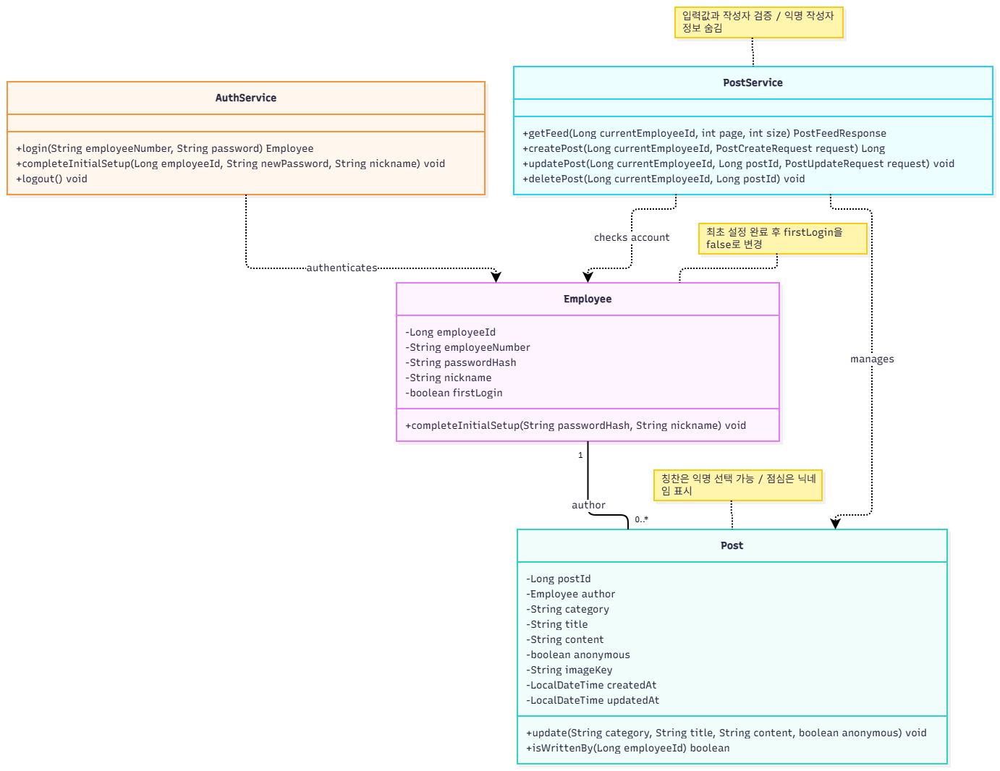

# 사내 게시판 클래스 다이어그램

**상태:** M5 작성 핵심 클래스 이미지 등록 · 전체 설계 최종 확정 전

[draw.io 편집 정보가 포함된 PNG](post_ClassDiagram.drawio.png)

현재 작성본은 Employee·Post와 AuthService·PostService의 핵심 구조입니다. Controller·Repository·요청/응답 DTO·사진 처리를 포함하는 전체 설계는 M5와 검토한 뒤 확정합니다.

## 최종본 작성 절차

1. 최신 요구사항과 ERD를 M5와 확인합니다.
2. 필요한 클래스와 메서드, 인증·권한·피드·사진 처리 범위를 함께 검토합니다.
3. 검토한 Mermaid 코드를 M5가 draw.io에 넣어 생성하고 수정합니다.
4. M5가 제공한 파일을 확인받아 최종 설계본으로 등록합니다.

[기존 미승인 전체 설계 제안](drafts/README.md)은 검토용으로만 보관합니다. 해당 파일의 v1.0·최종본 지위는 철회했습니다.

[게시판 ERD](../../erd/intranet/README.md) · [개발 코드](../../../apps/m1-intranet/README.md) · [클래스 목록](../README.md)
