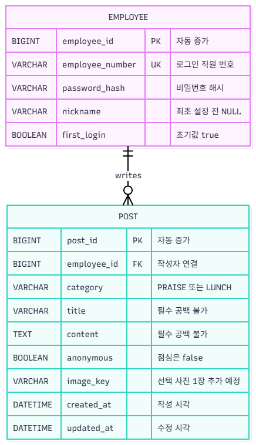

# ERD

**상태:** 게시판 설계 초안 등록 · M5 개발·검증 담당 · OTT·Store 설계는 별도 작성 예정

**작성:** M5 유은혜 / **초안:** 10/22 / **개발 설계·기능 검증:** M5 유은혜 / **배포 환경 확인:** M3 홍은서 / **연결:** [앱 개발 #8](https://github.com/team-blocks-lab/otter-shield/issues/8). 구현 후 실제 스키마·클래스와 대조하여 갱신합니다.

**작성 내용:** 앱에서 사용할 테이블, 기본키·외래키 및 관계. M5가 실제 DB 구조와 대조하고, 배포 담당자는 인계받은 스키마를 자신의 환경에 적용합니다.

작업 과정·실제 설정·시험 결과는 개인 Notion 기술서에 기록.

## 사내 게시판 ERD 초안

등록일: 2026.10.21. 초안 목표일 10/22에 앞서 게시판 설계를 등록했습니다. 한국·독일은 같은 스키마를 사용하되 DB·계정·환경설정을 분리합니다.

[draw.io 편집 정보가 포함된 PNG 열기](post_ERD.drawio.png)

- 직원 1명은 게시글을 0개 이상 작성하며 게시글은 작성자 1명에 연결됩니다.
- 칭찬은 익명 여부를 선택하고 점심은 닉네임으로 표시합니다. 익명 글도 DB에는 작성자 연결을 유지합니다.
- 사진은 선택 기능으로 추가할 계획이며 `image_key`는 저장된 파일의 식별값입니다. 미첨부 시 NULL을 허용합니다.
- 구현 전 VARCHAR 길이·NULL 허용·기본값·인덱스·외래 키 삭제 정책을 확정합니다. 제목·본문의 공백과 category·anonymous 조합은 서버에서 검증합니다.
- 현재는 게시판 범위의 설계 초안이며 실제 DB 생성·통합 시험 완료를 뜻하지 않습니다.

Java에서는 category를 PostCategory enum으로 정의하고 DB에는 PRAISE/LUNCH 문자열로 저장하는 설계입니다. [전체 클래스 설계 v1.0](class-diagram.md)과 함께 확인합니다.
